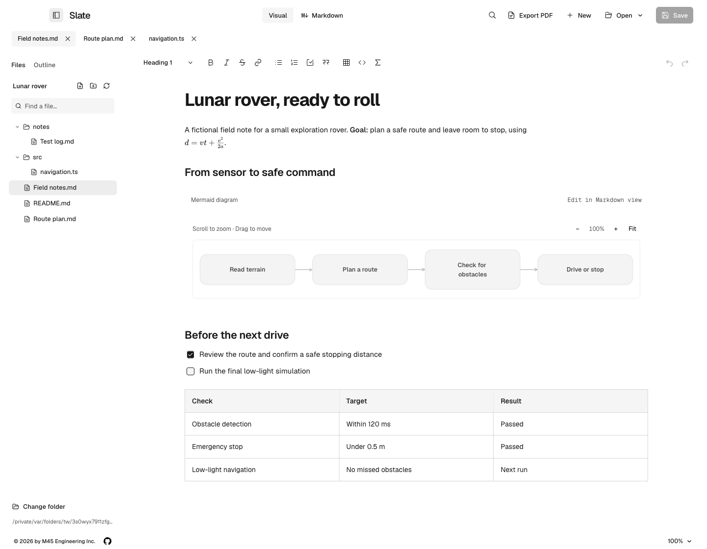

# Slate

A quiet place to write. A local Markdown, text, and code editor with document and model previews for macOS and Windows, built with Electron, Next.js, and Tiptap.



Your document is a `.md` file. Slate adds a familiar editing surface; it does not add a database, an account, or a proprietary document format.

## Install Slate

The desktop installers are self-contained. You do **not** need Node.js, pnpm, or this repository to use them.

### macOS

1. Download `Slate-0.1.12-mac-arm64.dmg` from the [v0.1.12 release](https://github.com/m45-engineering/slate/releases/tag/v0.1.12). This build supports Apple Silicon Macs; an Intel build is not yet available.
2. Open the `.dmg` and drag **Slate** to **Applications**.
3. Launch **Slate** from Applications or press **⌘Space** and type **Slate**.

Quit Slate before installing an update. Your remembered workspace and recovery drafts are stored separately from the app and are preserved when replacing it.

The Apple Silicon installer is ad-hoc signed, without Apple notarization. If macOS blocks a build you trust, use **System Settings → Privacy & Security → Open Anyway** after trying to open it. A Developer ID signature and notarization are still pending.

### Windows

1. Download `Slate-0.1.12-win-x64.exe` from the [v0.1.12 release](https://github.com/m45-engineering/slate/releases/tag/v0.1.12) for a standard Intel/AMD PC.
2. Run the `.exe` and follow the installation wizard. Installation is per-user; you can choose the destination folder.
3. Open **Slate** from the Start menu.

Quit Slate before installing an update. The Windows build is not yet signed with a trusted certificate, so Windows may show a publisher warning. Run it only if you trust its source.

Download both installers from the [v0.1.12 release](https://github.com/m45-engineering/slate/releases/tag/v0.1.12). They contain the code from that release, not later changes on `main`. The [Build Slate workflow](https://github.com/m45-engineering/slate/actions/workflows/build.yml) builds and tests newer changes on Windows and macOS. To try a newer successful build, download its matching artifact (`slate-windows-latest` or `slate-macos-latest`) and extract the ZIP. Downloading workflow artifacts requires GitHub sign-in; while the repository is private, downloads also require repository access.

## Features

- Visual editing and raw Markdown, with a document outline.
- Find and replace in the current document, with highlighted matches, next/previous navigation, match-case, and Replace All. Use ⌘F / Ctrl+F to find; ⌥⌘F on macOS or Ctrl+H on Windows to replace. Enter / Shift+Enter steps through matches; Escape closes the bar. Visual replacements preserve surrounding formatting; Markdown and source mode search the exact file text.
- A resizable shadcn folder sidebar with lazy directory browsing, live filename search, current-file highlighting, and an Outline tab. Markdown opens in the visual editor; text and code open in the source editor. PDFs, images, and supported model archives open as read-only previews. Word and Excel files open in their default apps; other unsupported files remain visible for context.
- Source editing with line numbers, Geist Mono, document zoom, and the same explicit Save and conflict protection. Supports TypeScript/JavaScript, Python, C/C++, SQL, JSON/JSONL, YAML, XML/XMI/ReqIF, HTML source, CSS, CSV, shell scripts, patches, plain text, and common extensionless files such as Dockerfile and Makefile.
- Create files and folders directly from the sidebar: use the icons beside the workspace name for the root, or right-click a folder for New File / New Folder. New files open in a tab; existing files are never replaced.
- Drag files or folders onto another folder in the sidebar to move them. Hovering expands a folder; drop onto the workspace heading to move back to the root. Open tabs keep their drafts and follow the move. Moves refuse existing destination names.
- Select multiple files with ⌘-click on macOS or Ctrl-click on Windows; Shift-click selects a visible range. Drag the selected group into a folder, or choose **Move N files…** from its context menu. Destination conflicts are checked before any file moves.
- Drop files from Finder or another file manager onto a sidebar folder or the workspace heading to copy them there. The originals stay in place; existing destination files are never replaced.
- Right-click files or folders in the sidebar (including search results) to rename, move, or delete them. Move uses the native folder picker within the open workspace; Delete confirms before sending the item to the system Trash. Open tabs follow renamed or moved files, including unsaved edits.
- Reveal a sidebar file, folder, search result, or saved tab in Finder on macOS or File Explorer on Windows from its right-click menu.
- Read-only Cameo/MagicDraw `.mdzip` previews with saved diagram positions, element details, tables, and relationship matrices.
- Read-only PDFs with selectable text, search, page navigation, and fit/zoom controls; image previews for PNG, JPEG, WebP, GIF, and SVG with fit, actual size, zoom, and drag-to-pan.
- Multiple document tabs with a blue dot for unsaved changes, individual close buttons, drag reordering, and a right-click menu for Close / Close Others / Close All. Switching tabs keeps each draft in memory. Crowded tab strips scroll horizontally without visible scrollbars; keyboard navigation brings the focused tab into view.
- Independent windows through **File → New Window** (⌘⇧N / Ctrl+Shift+N), each with its own folder, document tabs, unsaved drafts, and save prompts.
- Reopens saved workspaces and their file tabs in their previous order on restart, reading each file's latest contents from disk. Recovery drafts stay separate between windows.
- Opens centered at 96% of the current display's available width and height, leaving the menu bar and Dock or taskbar clear.
- A single compact toolbar, high-contrast controls with red destructive actions, and a blank document at startup.
- A wider visual document area and document zoom from 75% to 200%, without scaling the application controls.
- Headings, bold, italic, strikethrough, links, lists, checkboxes, and quotes.
- Editable Markdown tables and fenced code blocks with syntax highlighting in Visual view and PDF exports. Highlighting uses the fence language (for example, `typescript` or `ts`) and updates as you edit; plain text and unsupported languages stay uncolored. Mermaid diagrams use a rounded, shadow-free neutral style. Scroll over a diagram to zoom, drag to move it, and choose **Fit** to reset the view. Choose **Expand** for a nearly full-window canvas that resizes with the app; press Escape or **Close** to return to the same inline view. Add or edit their fenced source in Markdown view.
- Inline and display LaTeX formulas, rendered locally with KaTeX and preserved in Markdown and PDF exports.
- Local PDF export for Markdown, including Mermaid diagrams, tables, task lists, clickable web links, and page numbers.
- Native Open, Save, Save As, keyboard shortcuts, and `.md` / `.markdown` file associations.
- Explicit Save only: edits do not change the file on disk until Save or ⌘S / Ctrl+S. Save is active only while changes are pending; new documents need an initial Save to choose a filename. Closing a dirty tab, reloading, closing the window, or quitting offers Save / Discard / Cancel. Quitting and bulk close actions check each dirty tab separately; Cancel stops the remaining closes.
- Detection of changes made by other editors, with Reload and Save a copy actions.
- Bundled Geist Sans and Geist Mono; no font downloads or server at runtime.
- A local recovery draft for unsaved edits. This is a convenience, not a backup system.

## ReqIF requirements

Open a `.reqif`, `.reqif.xml`, or ReqIF `.xml` file to browse its specification hierarchy in **Visual** view. Navigation rows include a two-line text preview when the file defines a standard text attribute (such as `ReqIF.Text`, `Requirement Text`, or `Text`), a `Description`, or an XHTML attribute. Drag the divider to resize the navigation pane; Slate remembers its width. Search requirement names, identifiers, and attribute values; select an object to inspect its attributes and follow its declared relations. Objects outside specifications remain accessible.

Choose **Edit** beside an attribute, then **Apply** to update the document draft. String, boolean, integer, real, date, and enumeration fields use their declared definitions, including defaults and numeric limits. Rich text has an inert formatted preview; its editor exposes XHTML so formatting and embedded markup remain explicit. Embedded resources are not loaded. Unknown attributes and fields marked noneditable remain read-only.

**Save** writes the draft through Slate's normal file-conflict checks. Attribute edits patch the original XML rather than rebuilding the file: identifiers, hierarchy, relations, comments, and unrelated tool extensions are retained. Undo and Redo are available in the requirements toolbar. **Source** remains available for full XML editing; malformed documents stay in Source with an explanation. This version edits object attributes; creating objects, changing hierarchy or relations, editing type definitions, and opening compressed `.reqifz` packages are not included. It does not perform full ReqIF schema validation.

## Control structures

Open an M45 control structure YAML or JSON file to use **Visual** view for the diagram. Switch to **Source** to edit the same simple syntax as M45. These are separate views, like Visual and Markdown for a Markdown document. The file on disk stays YAML or JSON. Save updates the structured graph and authored source together, preserving existing record IDs and unrelated fields. Invalid edits keep the last valid preview and remain in recovery drafts until corrected; they cannot be saved as a canonical structure.

For a new structure, choose **New → New control structure**. It opens in **Source**, where you write M45’s simple syntax. Save creates one `.yaml` file containing the written source, graph, and layout, matching M45’s document format. No separate text file is needed. Control structures use `.yaml`, `.yml`, or `.json`; `.txt` files remain ordinary text. To create it directly in a folder, right-click that folder and choose **New File… → Template: Control structure (M45)**, or **New control structure…**. The sidebar’s New file button offers the same template at the workspace root. These actions create a `.yaml` file in the chosen folder immediately (you can also name it `.yml` or `.json`); the top New menu creates an unsaved tab and Save asks for its destination.

A minimal example:

```text
Pilot (controller) -> Hoist (actuator): Raise / lower / stop
Hoist -> Pilot: Operating state [feedback]

Pilot process model:
  Cable motion
  Load position

Pilot control algorithm:
  Stop when the operator releases the command.
```

Roles are `controller`, `process`, `sensor`, and `actuator`. Connections default to control; other suffixes are `[feedback]`, `[information]`, and `[effect]`. Use `Sensor measures Process` for an observation. Quote names or labels containing reserved punctuation, and indent controller details consistently. **Syntax help** includes an example.

Control structures use square blocks with a small uppercase role above each component name and orthogonal connectors. Selecting a block thickens its existing border without changing its role color; selecting a connector highlights its label. Click a block or connector, or activate it with Enter or Space, to open the compact **Show details** menu. The dialog lets you inspect and edit component names and roles, or connection labels, kinds, and endpoints. Controller details appear in the same resizable dialog. Changing a controller into another role warns before removing its process model and algorithm.

Click a process-model entry or algorithm rule to edit its text while its ID stays visible. **Add entry** and **Add rule** generate IDs automatically. Red trash buttons ask for confirmation before removing a row; its ID is retired when you apply the changes. Apply updates both sections together, and Cancel leaves the document unchanged. Older documents acquire missing rule IDs when saved. The dialog's copy button copies its details and reference IDs.

Add components or connections from the toolbar. Drag blocks to arrange them; arrows follow their endpoints. Drag the background to pan or scroll to zoom. Expand opens the entire control-structure editor with its editing toolbar, Visual/Source switch, and Save; collapse returns to the document without losing edits. **Auto-arrange** restores the automatic layout. The toolbar's red Delete button asks for confirmation; deleting a component also removes its incident connections and controller details. Undo restores deletions, applied edits, and layout changes. Save persists block positions in the M45 document's `views` field. Individual connector routing remains automatic.

**Copy diagram as image** copies the full diagram as a high-resolution PNG with a white background, regardless of the current zoom and pan. Selecting items and applying edits preserve the viewport; **Fit diagram** resets it explicitly. Reference IDs also appear beside controller blocks and their entries in the Source margin.

Markdown documents can embed the same text inside a `control-structure` fenced block. Visual view and PDF exports render the diagram; edit its text in Markdown view. Files whose graph disagrees with their stored source, unsupported grammar versions, and files without M45 authored text stay in Source view with an explanation.

## Run with pnpm

Development requires Node.js 24 and pnpm 10.33.0. People installing the packaged app do not need either.

```sh
git clone https://github.com/m45-engineering/slate.git
cd slate
pnpm install --frozen-lockfile
pnpm dev
```

Run these commands in a terminal such as Ghostty on macOS or PowerShell on Windows. `pnpm dev` launches the desktop app with live updates. The local UI server uses `127.0.0.1:3210`.

To open a repository during development, use `pnpm dev -- /absolute/path/to/repository`, or `pnpm dev -- C:\work\repository` on Windows. To restart development, quit Slate, stop the command with **Ctrl+C** if it is still running, and run `pnpm dev` again.

After the first session, `pnpm dev` resumes the open workspaces, saved-file tabs, their order, and active saved files. Passing the same folder also resumes its last file; explicitly passing another file or folder takes precedence. Missing paths are skipped with a notice. Slate stores workspace identities and remembered paths in `workspace.json` in its application settings directory, outside your repository. Unsaved documents use separate recovery storage for each window.

To build and run the production desktop app from source:

```sh
pnpm build
pnpm start
```

After changing the code, quit Slate and repeat `pnpm build` followed by `pnpm start` to load the new version. Avoid running the installed app and the development app at the same time; they use the same workspace settings.

`pnpm dev:web` starts a browser preview. The preview opens files with the browser's file picker and downloads changes. Native saves and external-change detection are desktop features.

## Open from other tools

After installing Slate on macOS:

```sh
open -a Slate /absolute/path/to/document.md
open -a Slate /absolute/path/to/repository
```

On Windows, pass the file to the installed executable in PowerShell:

```powershell
& "C:\path\to\your\Slate\Slate.exe" "C:\work\document.md"
```

Replace the example executable path with your installation directory. These commands also work from the VS Code terminal or an agent's shell. Alternatively use **Open With → Slate** in Finder or Explorer. There is no editor extension to install.

For development, after `pnpm build`:

```sh
pnpm start -- /absolute/path/to/document.md
```

Opening a document from another tool uses the active Slate window and adds a tab, or focuses its existing tab. Choose **File → New Window** to work with another repository independently. Closing a tab, closing a window, or quitting offers Save / Discard / Cancel when there are unsaved changes; quitting checks every window and checks again if you keep editing during a prompt. Open a folder from the Open menu or the sidebar. Expanding a folder reads its immediate children, so opening a repository does not scan every file. The tree refreshes when you return to Slate or click Refresh; `.git`, `node_modules`, `.next`, `.venv`, and `__pycache__` are hidden. Symbolic links are shown but cannot be opened from the tree. Opening a file directly shows its containing folder when no folder is already open.

| Action | macOS | Windows |
| --- | --- | --- |
| New | ⌘N | Ctrl+N |
| New window | ⌘⇧N | Ctrl+Shift+N |
| Open | ⌘O | Ctrl+O |
| Open folder | ⌘⇧O | Ctrl+Shift+O |
| Save | ⌘S | Ctrl+S |
| Save As | ⌘⇧S | Ctrl+Shift+S |
| Close tab | ⌘W | Ctrl+W |
| Find | ⌘F | Ctrl+F |
| Find and replace | ⌥⌘F | Ctrl+H |
| Next / previous match | ⌘G / ⌘⇧G | Ctrl+G / Ctrl+Shift+G |
| Next / previous tab | Ctrl+Tab / Ctrl+Shift+Tab | Ctrl+Tab / Ctrl+Shift+Tab |
| Bold / italic | ⌘B / ⌘I | Ctrl+B / Ctrl+I |

## Build installers

```sh
pnpm package:mac   # run on macOS: DMG for the current architecture
pnpm package:win   # run on Windows: NSIS installer for the current architecture
```

First run `pnpm install --frozen-lockfile`. Each packaging command regenerates the icons, builds the UI, and bundles Electron with the runtime assets. Outputs are generated in `release/` and are not tracked. Build and test on the target operating system with a matching Node.js architecture. The release workflow uses native macOS and Windows runners; a cross-built installer still needs runtime validation on its target OS.

[The build workflow](.github/workflows/build.yml) runs for pull requests and pushes to `main`, avoiding duplicate runs for PR branches. A lightweight change check skips the desktop jobs when only `README.md`, `CHANGELOG.md`, or files under `docs/` changed, including README images. Documentation-only changes do not install dependencies, run tests, or build installers, even when the validation cache is missing or expired. Application, test, and workflow changes use the existing per-platform validation cache and run the full checks and build when needed. An unavailable comparison commit also takes the build path. Maintainers can force fresh tests and installers with **Actions → Build Slate → Run workflow**. Full runs upload installers as build artifacts; they do not publish releases.

The initial update introducing documentation-only skipping also skips the desktop jobs when upgrading from the exact previous workflow version and no other application, test, or configuration files changed. Later workflow edits follow the normal build path.

CI explicitly enables certificate-free ad-hoc signing for macOS pull-request builds. Before uploading installers or caching successful validation, it mounts the finished DMG read-only and checks the enclosed app's signature and version with [the installer verification script](scripts/verify-mac-installer.mjs). A missing or invalid signature fails the build. This signing step does not use certificate secrets.

**Release status:** macOS packaging uses `identity: "-"`, `hardenedRuntime: false`, and `notarize: false` for a locally signed build without selecting a Keychain certificate. Build on the target architecture with its matching Electron installation. To avoid unverified-developer warnings, macOS builds need a Developer ID signature and notarization, and Windows builds need a trusted signing certificate. There is no automatic updater.

`pnpm icons` regenerates the app icon, startup mark, and installer background. `pnpm dev` and `pnpm start` use a cached, branded macOS launcher so development windows also appear as Slate. The original Electron dependency is left untouched.

## Text and code files

Open supported files from the sidebar, filename search, native file picker, or command line. Editable text files must contain UTF-8 text, contain no NUL bytes, and be no larger than 10 MB. PDF, image, and model previews are read-only and support files up to 50 MiB. Word and Excel files open externally.

Text and code use a source editor with line numbers, 12px Geist Mono text, and locally bundled syntax highlighting. Markdown source keeps its 13px text. The high-contrast colors preserve the white background. Files are never converted through Markdown, formatted automatically, or executed. HTML and MDX remain source text. SVG files open in the image viewer. Highlighting follows the filename for common programming, configuration, and markup languages. Plain text, unknown languages, and files over 200,000 characters use readable plain text to keep editing responsive. Code completion and language tooling are not included in this version. The shared supported-extension list is in [electron/file-types.cjs](electron/file-types.cjs).

## PDF, image, and model previews

Open a file from the sidebar, filename search, or **Open → Open file…**. Previews never save over their source files. If a file changes on disk, use **Reload file** to view its latest contents.

- **PDF:** Navigate pages, choose Fit width or Fit page, zoom, select text, and search with ⌘F / Ctrl+F. Password-protected PDFs prompt for a password. PDF.js and its rendering assets are bundled locally. Scanned pages without an embedded text layer cannot be searched; OCR, form editing, and annotation editing are not included. The preview currently omits PDF annotations. Use **Open in default app** when you need the original application's full PDF features.
- **Images:** View PNG, JPG/JPEG, WebP, GIF, and SVG. Choose Fit image or Actual size, zoom with the controls or a trackpad pinch, and drag to pan. Original image colors are preserved. SVGs load as images; their scripts are not executed. **Open in default app** is also available.
- **Cameo/MagicDraw models:** Open `.mdzip` archives containing a SysML v1/UML model. The viewer preserves saved positions and connector routes while using Slate's monochrome presentation. It supports block definition, internal block, package, requirement, use case, activity, sequence, parametric, state machine, and profile diagrams, plus generic tables, verification matrices, and allocation matrices. Search the diagram list, select a shape or relationship to inspect its properties, and resize the navigation and details panes.

Model previews use simplified notation rather than Cameo's rendering engine. Fonts, symbols, and compartments can differ. Matrices are reconstructed from saved scopes and explicit relationships; unsupported criteria are identified in the preview. A saved canvas containing only a frame is shown as such, with available linked interaction data. Missing layouts, unresolved references, and unsupported content are reported instead of invented. External project models are not loaded, and model behavior is never executed. `.sysml` and `.kerml` files remain source text rather than SysML v2 diagrams.

Word and Excel documents—including `.doc`, `.docx`, `.xls`, and `.xlsx`—open in the operating system's default application without creating a Slate tab. If no application is associated with the file, Slate reports the error. CSV and TSV files continue to open in the source editor.

## Markdown fidelity

Opening, switching views, and saving without edits preserve the original file bytes and modification time. Editing in raw Markdown saves that source. Visual edits serialize the document through Tiptap and can normalize Markdown formatting (for example, table spacing and emphasis markers). UTF-8 BOM and CRLF line endings are retained for existing files.

This version deliberately keeps YAML/TOML front matter, HTML, images, reference definitions, and footnotes in source mode. It does not claim lossless visual editing for every Markdown dialect. The source-mode guard covers these known unsupported forms; other custom Markdown extensions may also require source editing. Tiptap's Markdown extension is currently beta.

Mermaid uses strict rendering. Code is displayed, never executed. Link destinations appear in the footer on hover or focus. Linked documents inside the open folder open in Slate; web links show their full URL in a confirmation before opening the default browser. Heading links such as `#getting-started` and `guide.md#getting-started` scroll to the target heading. Repeated headings use suffixes such as `-1` and `-2`. Remote images and embedded HTML are not rendered. File operations are restricted to the selected documents and open workspace.

### Formulas

Write inline LaTeX as `$E=mc^2$` and display LaTeX between `$$` delimiters on separate lines. Formulas render in Visual view and PDF exports. Use **Insert formula** in the formatting toolbar, or click a rendered formula to edit its LaTeX. KaTeX and its fonts are bundled locally; only its supported LaTeX commands are available. Invalid formulas show their source, and PDF export stops with an explanation until they are corrected. Shell variables inside code and ordinary dollar prices remain literal text.

### Export a PDF

Choose **Export PDF** in the toolbar or **File → Export PDF…**, then choose where to save it. Export uses the current document, including unsaved edits, without saving or changing the Markdown file. It works from either Visual or Markdown view.

PDFs are rendered entirely on your computer using Slate's bundled Chromium and fonts. They include A4 pages, page numbers, selectable text, clickable web links, and rendered Mermaid diagrams. Wide diagrams receive a landscape page when that improves readability; oversized diagrams get one larger page to keep their text readable. Diagram layout matches Visual view, independent of canvas zoom or position. Editor controls and source-editing fields are omitted. An invalid diagram stops export instead of silently producing a missing or outdated figure.

Export supports the same Markdown content as Visual view. The source-only constructs listed above are rejected explicitly so they cannot silently disappear. Custom headers, a generated table of contents, and Word export are not included.

Saving compares the file with the version Slate opened. If another tool changed or deleted it, Slate refuses to overwrite it. Writes use a temporary sibling file and rename; this reduces partial-write risk. This is not a distributed lock: a write by another process in the tiny interval between the final comparison and rename can still race. Use Git for version history and coordinated review.

Save checks for external changes and preserves unsaved text if a write fails. Choosing Save in the confirmation dialog continues only after the file is successfully saved; canceling Save As, a conflict, or a write error leaves the document open. Reload the external version, save a copy, or retry Save as appropriate.

Draft recovery still runs automatically in local application storage, separately from your files. After an interrupted session, recover each draft as a new unsaved tab. Recovery covers all dirty tabs, including inactive ones. Saving or explicitly discarding a draft removes only its own recovery copy. Recovery never writes edits into the original repository file.

## Validation

```sh
pnpm check       # TypeScript and file-preservation/conflict tests
pnpm build       # static production export
pnpm test:e2e    # launch Electron; requires a desktop session
```

[Desktop tests](tests/desktop.spec.ts) exercise the actual exported app, including native file loading, Markdown round trips, source editing and explicit saving, Save / Discard / Cancel, draft recovery, session restore, table editing, Mermaid rendering, PDF export, web links, and external changes. [File tests](tests/file-store.test.cjs) cover byte preservation, line endings, conflicts, read-only previews, and invalid files. [Preview tests](tests/file-preview.spec.ts) cover PDF rendering/search, image navigation, and default-app dispatch. [Model tests](tests/model-viewer.spec.ts) cover saved layouts and element inspection; the optional full DellSat check requires `SLATE_MDZIP_SAMPLE` to point to a local archive, which is not bundled with the repository.

## License

Slate's original code is licensed under the [PolyForm Noncommercial License 1.0.0](LICENSE).

Use, modification, and redistribution are free for the license's permitted noncommercial purposes. The standard license also expressly permits use by charitable organizations, educational institutions, public research organizations, public safety or health organizations, environmental protection organizations, and government institutions. See the full terms for the precise scope.

Commercial use outside those permitted purposes requires a separate license from [M45 Engineering](https://m45.engineering/). No commercial license is granted by this repository.

This is source-available software with a noncommercial restriction, rather than an OSI-approved open-source license. The license applies to Slate's software; it does not place your documents under that license. Third-party components retain their own licenses. Redistributed copies must include the license terms (or their URL) and the [required notice](NOTICE).

## Repository access and contributions

Slate is maintained by [Florian Wolf (@florian-zeev)](https://github.com/florian-zeev) under [M45 Engineering](https://github.com/m45-engineering/slate). External pull requests are not accepted. Repository write access is reserved for the maintainer, subject to organization owners' administrative access.

GitHub is configured with **Pull requests → Collaborators only**, with `florian-zeev` as the only account with write/admin access and no repository teams or deploy keys. Making the repository public should retain that restriction. GitHub organization owners retain administrative authority over organization repositories, so review access again if the organization's ownership or base permissions change. A public repository can still be read and forked; these settings control changes to the official repository, not copies made by other people. See [GitHub's pull request settings](https://docs.github.com/en/repositories/managing-your-repositorys-settings-and-features/enabling-features-for-your-repository/disabling-pull-requests).

Before making the repository public, review the repository history and distribution/signing setup. Private customer meeting notes and local build artifacts are not included in the source tree. This local licensing change does not alter previously published release assets.

## Implementation

The Next.js UI is exported into `out/` and loaded by Electron through a local `slate-app://` protocol. The installed application runs without a Next.js server. The sandboxed renderer accesses native file operations through a small preload bridge. Document content remains local.

- `src/components/slate-editor.tsx`: document UI and the two editor views.
- `src/components/code-block.tsx`: fenced code and Mermaid previews.
- `electron/main.cjs`: application lifecycle, window routing, and workspace persistence.
- `electron/workspace-window.cjs`: each window's menus, native dialogs, documents, and file watching.
- `electron/file-store.cjs`: UTF-8 and read-only binary file I/O, conflict checks, and replacement writes.
- `src/components/pdf-viewer.tsx` and `image-viewer.tsx`: local, read-only file previews.
- `src/components/model-viewer.tsx` and `src/lib/mbse/`: model import, saved diagrams, tables, and element inspection.
- `electron/folder-store.cjs`: directory listings and access restricted to the selected folder.
- `src/components/folder-sidebar.tsx`: the shadcn folder navigator and Outline tab.

The monochrome design follows M45's white space, neutral palette, and Geist typography. The shadcn components in `src/components/ui/` use the standard Radix primitives. The sidebar's default bold shortcut was changed to preserve the editor's ⌘/Ctrl+B behavior.

All visible application controls use these shared components: buttons, text inputs, source textareas, mode tabs, menus, tooltips, task checkboxes, and confirmation dialogs. Native operating-system menus and file pickers handle application commands and file selection. The browser fallback uses one hidden file input to launch its system picker.

Keep M45 colors and typography in `src/app/globals.css`: near-black text, readable secondary text, white surfaces, restrained hover backgrounds, and explicit keyboard focus. Avoid native `title` tooltips, browser confirmation dialogs, decorative borders, and per-control gray overrides. Heading previews share the document's type-size tokens. The desktop tests check component usage, minimum 4.5:1 text contrast for enabled buttons, keyboard focus, and confirmation behavior.

Current scope is a focused local editor. Collaboration, Git operations, Word export, plugins, and cloud sync are not part of this version.
